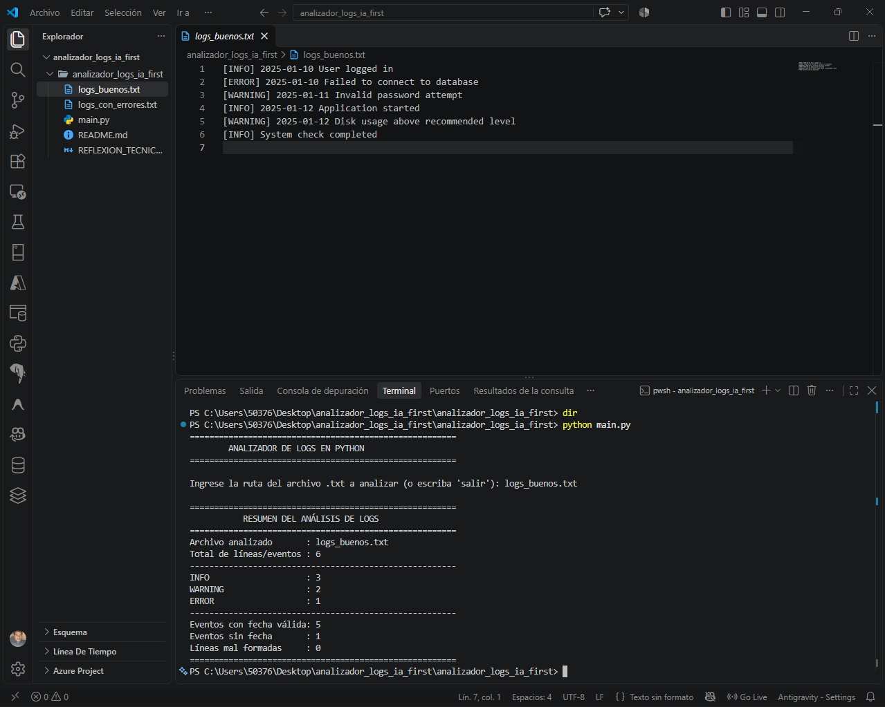
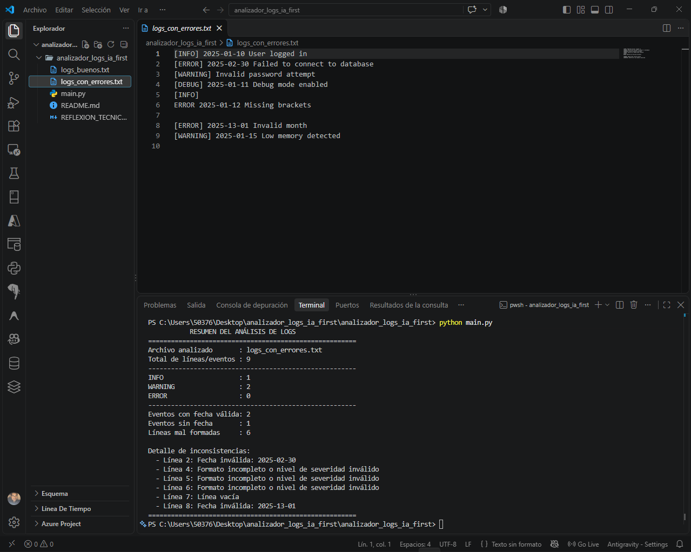

# Analizador de Logs con Python e IA como herramienta de apoyo

## Descripción

Este proyecto analiza archivos de texto que simulan registros o logs de una aplicación.

Cada línea puede contener:

- Nivel de severidad: `INFO`, `WARNING` o `ERROR`.
- Una fecha opcional con formato `YYYY-MM-DD`.
- Un mensaje descriptivo.

El programa muestra un resumen en consola con:

- Total de líneas analizadas.
- Cantidad de eventos `INFO`.
- Cantidad de eventos `WARNING`.
- Cantidad de eventos `ERROR`.
- Eventos con fecha válida.
- Eventos sin fecha.
- Número de líneas mal formadas.
- Detalle de las inconsistencias encontradas.

## Estructura

```text
analizador_logs_ia_first/
├── main.py
├── logs_buenos.txt
├── logs_con_errores.txt
├── README.md
└── REFLEXION_TECNICA.md
```

## Requisitos

- Python 3.10 o superior recomendado.
- No requiere librerías externas.

## Cómo ejecutar

Abrir la carpeta del proyecto en VS Code y ejecutar:

```bash
python main.py
```

Después escribir la ruta del archivo a analizar.

Ejemplos:

```text
logs_buenos.txt
```

o

```text
logs_con_errores.txt
```

## Reglas de validación elegidas por el estudiante

Las siguientes reglas no fueron delegadas a la IA; se definieron como decisiones técnicas del desarrollador:

1. Una línea válida debe iniciar con `[INFO]`, `[WARNING]` o `[ERROR]`.
2. La fecha es opcional.
3. Si una fecha aparece, debe usar `YYYY-MM-DD` y representar una fecha real.
4. Una línea sin fecha puede ser válida si contiene severidad y mensaje.
5. Una línea vacía se considera mal formada.
6. Una línea con nivel no reconocido se considera mal formada.
7. Una línea sin mensaje se considera incompleta.
8. Una línea mal formada sigue formando parte del total de líneas analizadas, pero no se suma a las categorías INFO/WARNING/ERROR válidas.

## Uso de IA

La IA se utilizó como apoyo para:

- Proponer una expresión regular.
- Sugerir dividir el programa en funciones.
- Revisar casos borde.
- Explicar el uso de `datetime.strptime`.
- Ayudar a documentar el proyecto.

Las decisiones sobre qué es una línea válida o inválida fueron tomadas por el estudiante.

## Evidencia de pruebas

### Caso 1: `logs_buenos.txt`

Contiene seis eventos bien estructurados.

Resultado esperado:

- Total: 6
- INFO: 3
- WARNING: 2
- ERROR: 1
- Líneas mal formadas: 0
- Con fecha: 5
- Sin fecha: 1

### Caso 2: `logs_con_errores.txt`

Incluye fechas imposibles, un nivel no permitido, una línea sin mensaje, una línea sin corchetes y una línea vacía.

Resultado esperado:

- Total: 9
- INFO válidos: 1
- WARNING válidos: 2
- ERROR válidos: 0
- Líneas mal formadas: 6
- Eventos con fecha válida: 2
- Eventos sin fecha: 1

## Evidencias de ejecución

### Prueba 1 — Archivo bien formado

El archivo `logs_buenos.txt` fue analizado correctamente y produjo los resultados esperados.



### Prueba 2 — Archivo con errores

El archivo `logs_con_errores.txt` permitió comprobar la detección de fechas inválidas, formatos incompletos, niveles no permitidos y líneas vacías.




## Autor
William Antonio Hernández Iraheta -
Actividad académica — IA-first mindset.
